# 10.12周报

## 1.DOA测角综述

### 真实世界当中接收数据是怎么产生的

我们想象一个均匀线性阵列，假设目标回波从某个方位角入射雷达接收阵列，DOA要解决的问题就是，已知所有阵元接收到的数据，我们来估计回波信号从什么角度到达

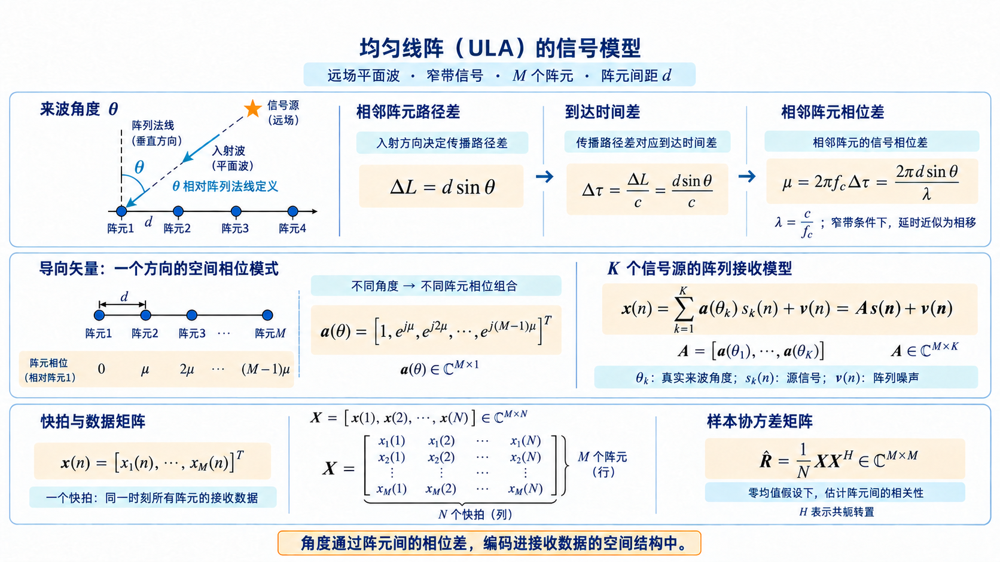

### DOA测角算法要怎么做

连续采集***$N$个快拍$X$*→**估计***协方差矩阵$R$***→选取***DOA算法***→提取***阵元间的空间相位结构***→进行***角度$θ_i$求解***

## 2.D4RT-动态场景4D重建

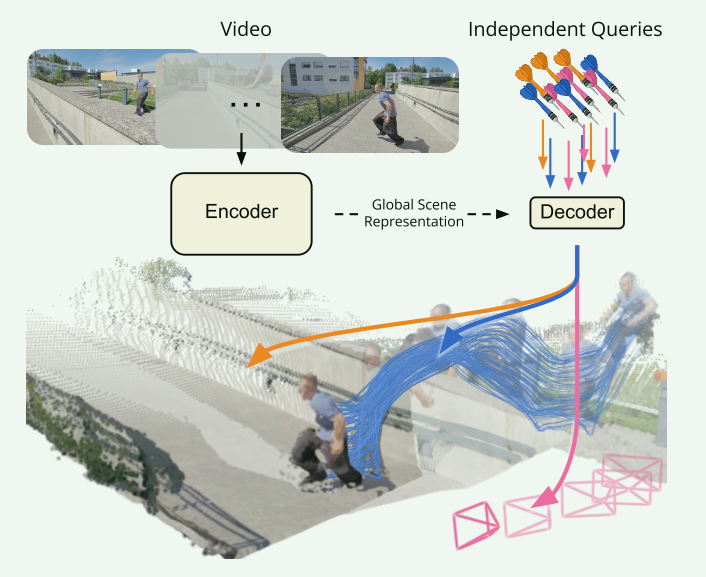

***输入：***一整段包含多个时刻的***视频$V=\{I_1,I_2,\ldots,I_T\}$***

***编码：***视频会首先进入***编码器$F=E(V)$***，编码器会综合全部视频帧，进而提取场景外观、物体结构、物体运动、相机运动等信息，$F$也就是一个视频的全局场景表示

***解码：***模型会将***查询$q$***以及***全局表示$F$***一起送入***解码器$P=D(q,F)\in\mathbb{R}^{3}$***，然后输出 $P=(X,Y,Z)$ 三维点

***三维点云重建：***对视频画面中的像素进行查询，就会得到***三维点$\{(u_i,v_i)\}_{i=1}^{N} \longrightarrow \{(X_i,Y_i,Z_i)\}_{i=1}^{N}$***

大量三维点就组成了***三维点云***，通过三维点云，我们可以了解某一时刻场景中的三维结构

***三维点轨迹重建：***选择某一帧当中人身上的像素 $(u,v,t_{\mathrm{src}})$，并且保持不变，令 $t_{\mathrm{tgt}}$ 开始变化，模型就会输出 $P_1,P_2,\ldots,P_T$ 这样的三维点，把生成的三维点连在一起，就形成了三维点轨迹 $\mathcal{T}=\{P_1,P_2,\ldots,P_T\}$

***恢复相机参数：***模型可以查询同一批点在相机坐标系下的三维位置，在根据两组对应三维点之间的联系，来计算出相机参数，包括像相机位置、相机朝向、相机观察方向

***编码器主要负责“理解整段视频”，解码器负责“回答一个具体问题”***

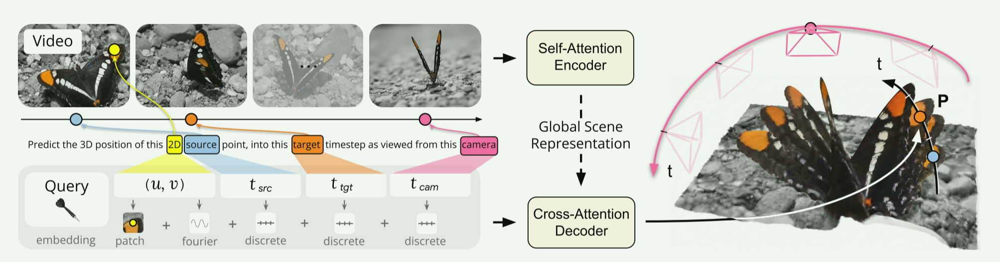

这张图描述的过程：

$$
\boxed{V\xrightarrow{\text{Encoder}}F,\qquad q=(u,v,t_{\mathrm{src}},t_{\mathrm{tgt}},t_{\mathrm{cam}})\xrightarrow[\text{读取 }F]{\text{Decoder}}P=(X,Y,Z)}
$$

查询Token的最终表达式：$z_q=e_{\mathrm{query}}+e_{\mathrm{patch}}+\phi(u,v)+e_{\mathrm{src}}(t_{\mathrm{src}})+e_{\mathrm{tgt}}(t_{\mathrm{tgt}})+e_{\mathrm{cam}}(t_{\mathrm{cam}})$

### 2.1原视频预处理和Token化

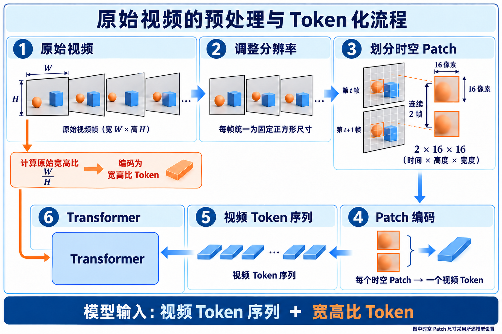

### 2.2自注意力编码

视频Token会被送入Transformer编码器当中

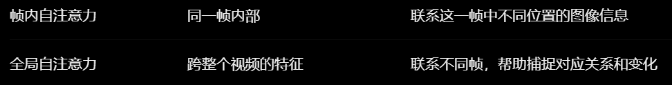

### 2.3交叉注意力解码

$CrossAttention(Q=z_q,K=F,V=F)$

### 2.4最终输出

$$
(z_q,F)\xrightarrow{\text{交叉注意力解码}}\text{输出特征向量 }h_q
\xrightarrow{\text{输出投影}}P=(X,Y,Z)
$$

### 2.5模型如何生成不同任务

#### 深度估计

$t_{\mathrm{src}}=t_{\mathrm{tgt}}=t_{\mathrm{cam}}=i$，查询第 $i$ 帧的所有像素，并提取输出的 $Z$ 分量，$Z$ 就是沿相机光轴方向的深度

#### 三维点跟踪

固定 $(u,v,t_{\mathrm{src}})$，改变 $t_{\mathrm{tgt}}$

#### 三维点云

对大量像素进行查询，同时固定 $t_{\mathrm{cam}}=r$，使所有三维点都用同一个参考坐标系，一个像素对应一个三维点

#### 相机位姿

保持物理点和目标时刻不变，只改变 $t_{\mathrm{cam}}$，得到同一批三维点在不同相机坐标系中的表示，再计算坐标系之间的旋转和平移

## 3.雷达matlab

### 3.1距离-多普勒图

回波信号进行匹配滤波后，对脉冲压缩的结果做慢时间Doppler FFT，得到距离-多普勒图

从图中我们可以看出

- 目标相对于雷达具有径向速度，于是就产生了多普勒频移
- 近地杂波信号近似静止，因此径向速度近似为0
- 当目标径向速度明显超出地杂波时，可以在距离–多普勒图的速度维上将运动目标与地杂波分开

于是我们就可以直观的看到目标信号和杂波信号的区别

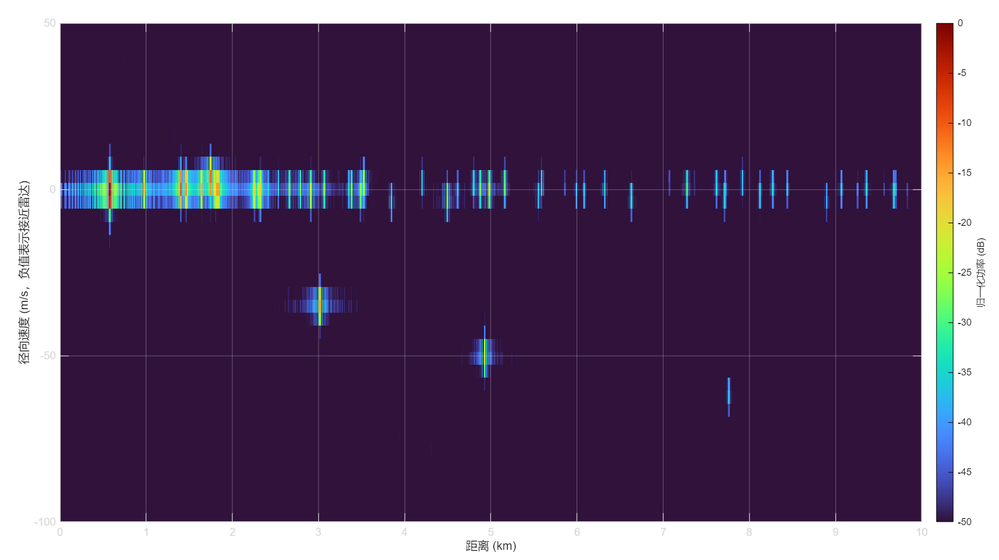

### 3.2 二维CFAR检测

在距离-多普勒的基础之上，采用二维CA-CFAR进行检测

为了避免强地杂波造成大量虚警，检测时对零速度附近的杂波区域设置保护带，不在该区域内进行目标判决

经过二维 CFAR 检测后，共检测到三个运动目标

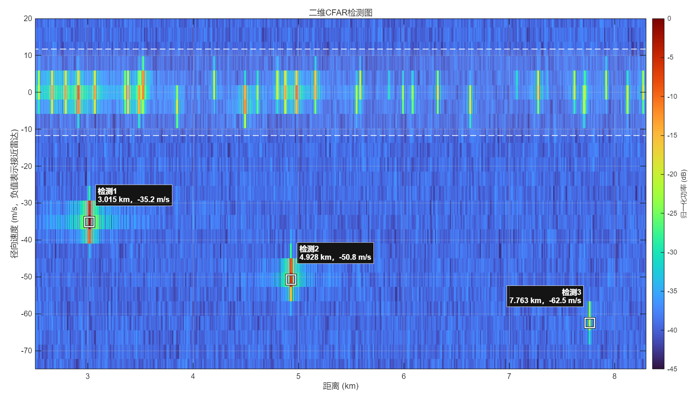

### 3.3测角

对二维CFAR检测出的三个目标，程序模拟了一个16阵元的均匀线阵，测角正是根据目标信号到达各个阵元的相位差不同来进行的。

Bartlett波束形成是一种经典的测角方法，它会依次假设目标来自不同的角度，然后根据假设的角度来构造出对应的阵列导向矢量$\boldsymbol a(\theta)$，接着计算功率，如果角度正确的话，各阵元同相相加，能量很大，会产生峰值，峰值处就是真实角度的位置

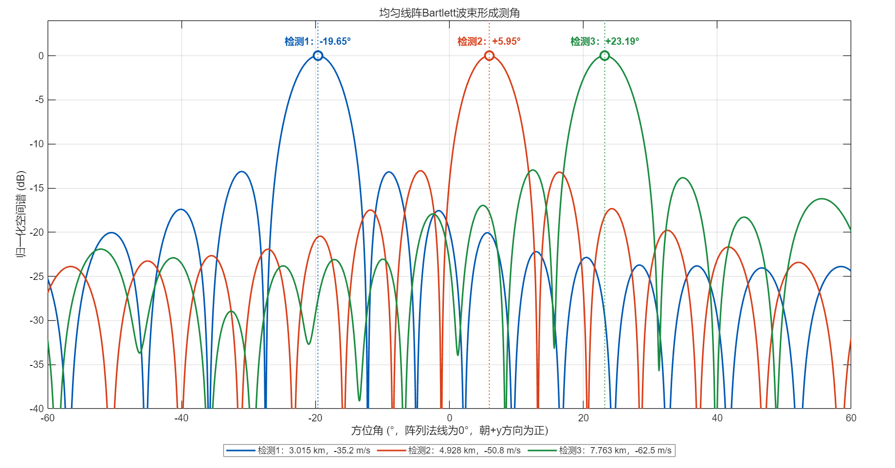

### 3.4航迹跟踪

选取10帧雷达连续观测，每一帧都已完成了二维CFAR检测和测角，得到目标的一些参数 $\mathbf z_k=\begin{bmatrix}R_k\\v_{r,k}\\\theta_k\end{bmatrix}$

轨迹跟踪就是把连续10阵的这些值给连起来

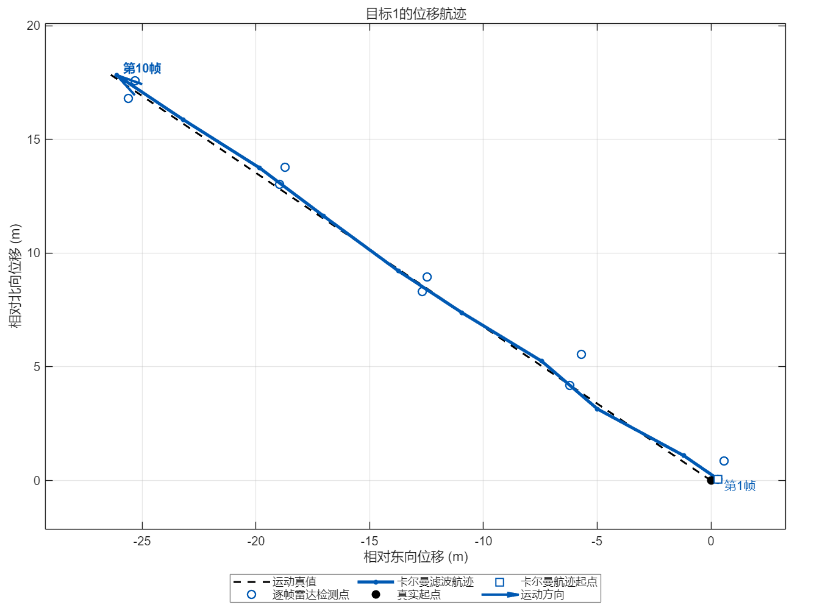

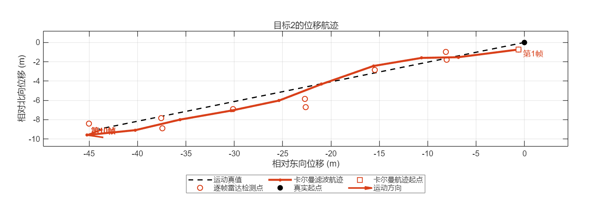

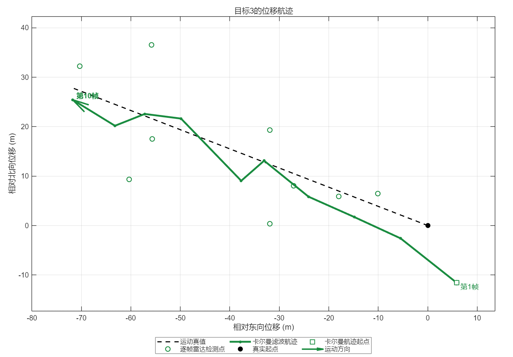

## 下周计划：把DOA测角和D4RT的源码尝试着跑一下
