# 10.19周报

## 1.飞鸟与无人机目标雷达探测与识别技术进展与展望论文阅读

## 整体认识

***左图***展示的是“低慢小”目标在幅度域和时频域的回波特征，可以发现的是由于目标回波能量小，与周围杂波接近，因此仅凭幅度难以将目标与噪声和杂波区分来开

***右图***引入了时间和速度信息，目标在特定速度位置持续出现，形成较为集中的能量结构，与背景噪声相比更容易辨认

因此，对于“低慢小”的目标而言，需要综合利用距离、速度、回波强度和时间来进行连续观测，这样才能较为准确

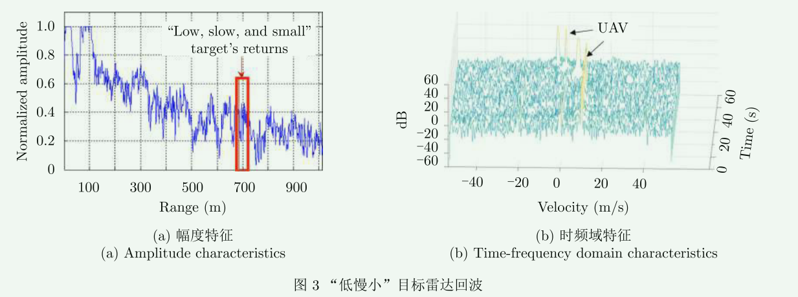

## 1.1如何从杂波和噪声背景下提取出弱小目标，并最后完成识别

### 1.1.1多普勒和微多普勒

目标与雷达之间的***距离***发生变化时，***回波相位***随时间的变化而变化，从而产生***多普勒频移***

***多普勒***：描述目标整体相对雷达的运动

***微多普勒***：描述目标内部部件或附加运动产生的周期性、时变频率调制，主要描述来自目标整体平移之外的附加运动

- 旋翼转动
- 鸟翼扑动
- 发动机叶片转动
- 人体手臂摆动

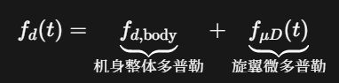

微多普勒不是一个固定频率，而是在***正负频率之间周期变化***

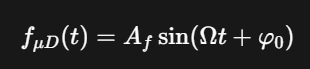

因此通常采用***短时傅里叶变换***来观察，通过把长信号分成许多短时间窗口，然后***每个窗口分别做傅里叶变换***

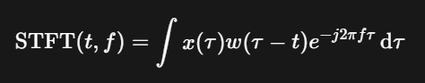

### 1.1.2主体多普勒和微多普勒在图上的区别

***主体多普勒：***主体多普勒是无人机机身整体运动产生的多普勒，其径向速度相对稳定，所以回波能量集中在一个比较窄的速度区域

***微多普勒：***微多普勒是旋翼叶片高速转动产生的多普勒，呈现向正负速度两侧大范围展开的能量

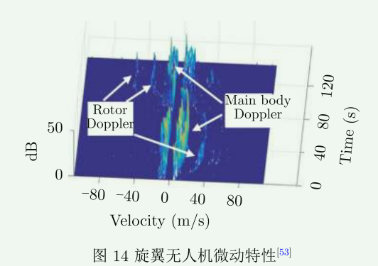

### 1.1.3飞鸟与无人机微动特性差异

图中三类目标的***主体多普勒均位于零速度附近***，说明其***主体径向速度近似为零***，或主体运动产生的***多普勒分量被补偿***

由于飞鸟翅膀扑动与无人机旋翼转动在微动速度、周期和规律性等方面存在明显差异，因此形成了不同的微多普勒带宽和时频纹理，同时由于RCS的不同，导致回波能量会有差异

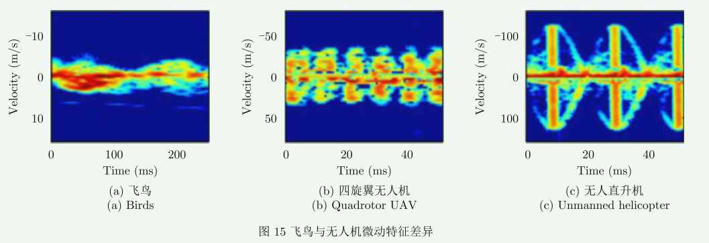

### 1.1.4飞鸟目标雷达微动特性分析、

图（a）给出了仿真飞鸟的三维运动轨迹

图（b）表示在长时间观察过程中飞鸟产生了明显的距离移动

图（c）和图（d）分别展示的是中心频率微658MHz和900MHz时的飞鸟多普勒特征

由于飞鸟整体平移决定主体多普勒频移，而鸟翼在随鸟体整体平移的同时还进行周期性扑动，因此鸟翼回波既包含主体多普勒分量，还会产生微多普勒特征

900MHz对应的波长相对于更短，因此相同微动速度产生的多普勒频移更大，所以其微多普勒展开相比658MHz要更明显

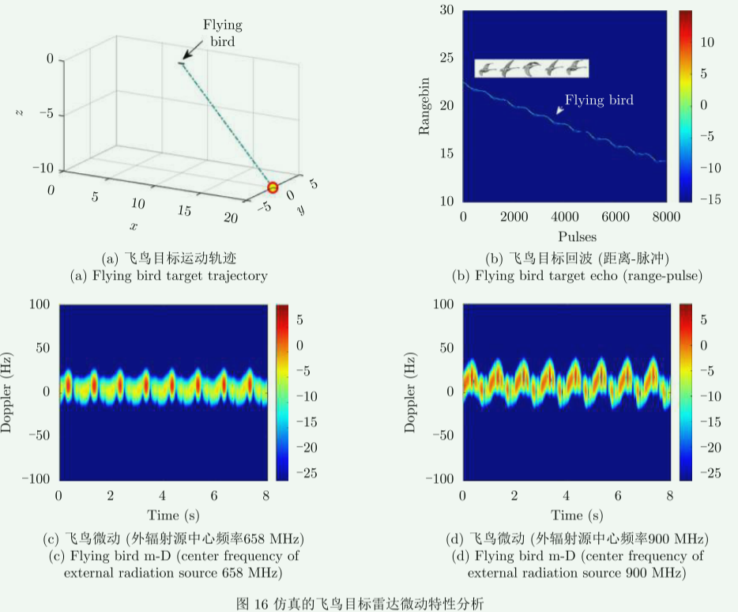

### 1.1.5无人机目标雷达微动特性分析

悬停无人机的主体多普勒位于零频附近，而高速旋翼在正负多普勒附近产生持续的微多普勒分量，为无人机检测与识别提供了特征依据

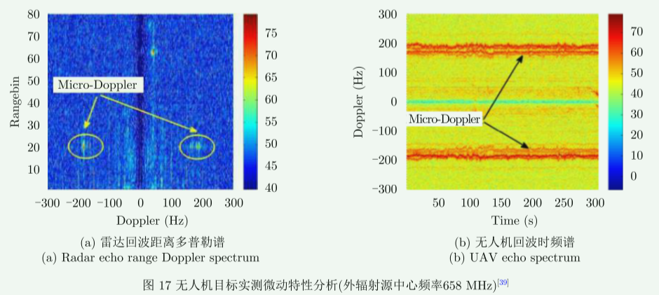

### 1.1.6快时间和慢时间

***快时间：***在一个脉冲重复间隔内，以发射脉冲的时间为基准，对接收回波进行高速采样的时间

在回波到达之前，接收机进行采样，但此时采样点包含的往往是噪声、杂波等，而等回波到达之后，采样数据中出现目标回波，后续会通过匹配滤波或脉冲压缩找出回波出现的位置

***慢时间：***雷达不间断地重复发射脉冲，把同一个距离单元在不同脉冲中的复数回波排列起来，就得到慢时间序列

如果目标运动，它的距离和回波相位会在脉冲之间逐渐变化。通过这种脉间相位变化可以得到多普勒频率

### 1.1.7雷达测距和测速的大致流程

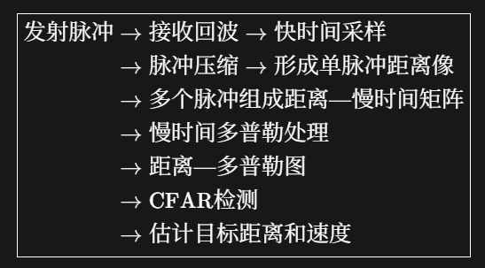

## 1.1.7回波信号

### 无人机回波信号

### 飞鸟回波信号

### 1.1.8飞鸟和无人机目标识别算法流程

雷达接收到模拟回波之后，会进行信号处理，通过

- 射频接收，滤波
- ADC采样
- 脉冲压缩
- 杂波抑制
- 多普勒处理
- CFAR检测

讲目标和杂波或噪声区分开来，然后进行

- 提取目标的距离、方位和径向速度等量测信息
- 目标跟踪
- 目标分类识别

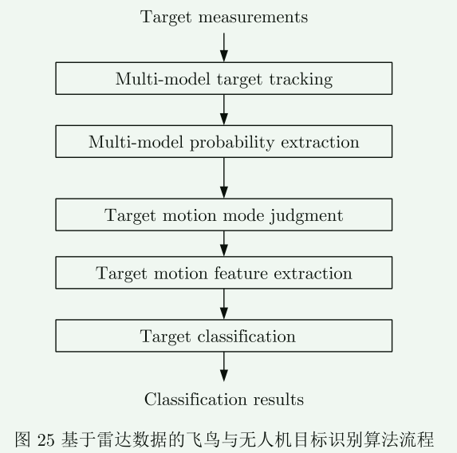

## 2.海空背景下低慢小目标泛探雷达多域多维特征建模与分析

### 2.1已有的研究缺口是什么

论文认为，传统雷达存在三个主要限制：

- 多普勒分辨率不足
- 脉冲回波数据维度较少
- 可稳定提取的目标特征有限

传统研究往往更依赖微多普勒，但低慢小目标在传统扫描雷达中容易暂时丢失，导致微多普勒特征不连续、不稳定

### 2.2数字阵泛探雷达

采用宽波束持续照射一大片空域，再利用数字阵列在接收端同时形成许多窄波束，对这片空域里的多个目标持续观察

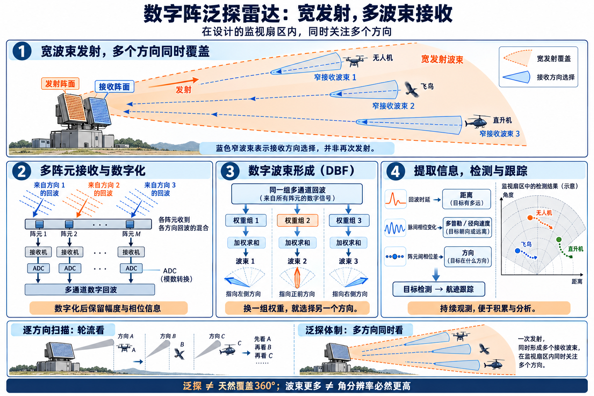

#### 2.2.1为什么需要数字阵泛探雷达

（1）***“小”目标RCS小，回波弱，因此需要长时间累积***

数字阵泛探雷达可以***连续观察目标***，将多个***脉冲回波进行积累***，积累脉冲越多，弱目标越容易从噪声中显现

（2）***“慢”目标径向速度小，因此多普勒频率低，容易落在低杂波、海杂波等低频区域***

数字阵泛探雷达可以***长时间观察目标***，而由于***多普勒分辨率***与观察时间近似成反比$ \Delta f_d \approx \frac{1}{T_{\text{obs}}} $，观察时间越长，多普勒分辨率越高，越能将慢速度目标与杂波区分开来

（3）***微动特性需要连续观测***

旋翼无人机的叶片高速旋转、直升机旋翼转动、飞鸟翅膀扑动，都会产生***微多普勒***

而这些微动都***具有时间变化规律***。如果雷达只断断续续看到目标，微多普勒***结构可能不完整***

连续观测更容易获得特征信息

### 2.3CPI（相干处理时间）

雷达连续发射$M$个相干脉冲，假设脉冲重复间隔$PRI$，那么$ T_{\mathrm{CPI}}\approx M\cdot \mathrm{PRI} $

CPI是雷达为相干处理划定的一段有限观察时间

- 一个脉冲→测距离
- 一个CPI→相干积累、测量多普勒和径向速度
- 多个CPI→形成速度序列、加速度特征和目标航迹

### 2.4微多普勒谱的提取流程

直升机有着不同的散射点，因此产生的多普勒频率不同

- 机身
- 主旋翼
- 尾桨

频谱不再只有一个主体峰，而是在一定频率范围内出现多个峰值和频率扩展

左图经过零频杂波滤除、对数正则化、主频对齐和主体频率抑制得到

右图由原始采集数据进行STFT得到

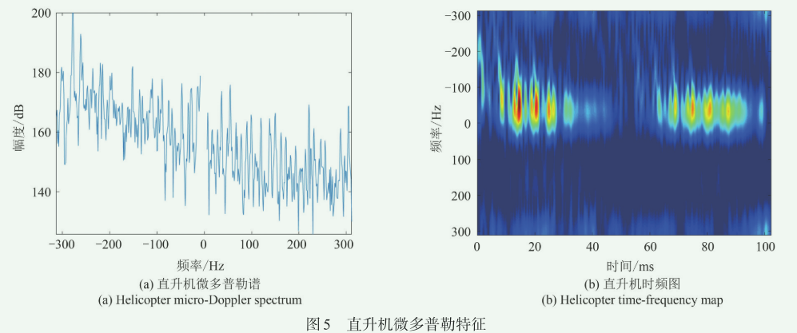

### 2.5雷达获取的目标特征

***时域回波特性：***

- 单帧脉冲回波特性：

单帧→一个CPI内的一组脉冲，将一个CPI中各个脉冲的回波幅度取出来，可以看到***目标等效散射强度的短时间变化***

- 动态脉冲回波特性：

把多个连续帧连接起来，观测***更长时间内回波幅度和能量的变化***

***变换域多普勒特征：***

- 多普勒瀑布图：

对每一个CPI内的脉冲序列沿慢时间做FFT，就能得到这一帧的多普勒谱，再把很多帧按时间排列起来，就形成多普勒瀑布图，主要回答***目标的多普勒频率怎样随时间变化***

- 微多普勒谱

在目标整体运动之外，观察旋翼、螺旋桨、鸟翼等部件的微小运动，从而***判断目标结构和辅助识别目标类型***

***长时间机动特征：***

- 加速度序列：

***判断目标的速度变化是否平稳***，从而***衡量目标的机动性***，并辅助区分不同类型的目标、

- 加加速度序列：

是加速度的变化率，描述加速过程改变得有多突然，用于***反映目标运动中的抖动、震动以及机动切换***

- 航迹特征：

看目标在一段较长时间里走了什么路线、转弯是否频繁、飞行是否平稳，从而***描述目标的整体运动方式，并辅助分类和跟踪***

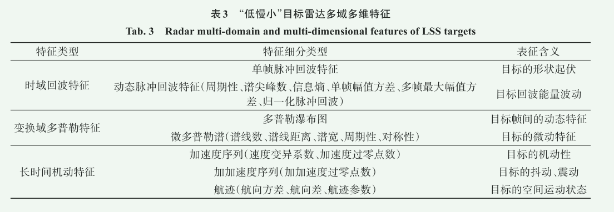

### 2.6“低慢小”目标雷达多域多维特征总结归纳

***强杂波抑制：***

雷达接收回波***不是纯目标回波***，而是$ x(t)=s_{\text{target}}(t)+s_{\text{clutter}}(t)+n(t) $，由于目标“低慢小”的原因，可能会出现$ |s_{\text{clutter}}(t)| \gg |s_{\text{target}}(t)| $，因此需要***抑制强杂波***

***波束形成：***

经过杂波抑制之后，雷达还需要***判断回波来自哪个方向***

对需要观察的方位角$\theta$，按照这个方位，对各阵元数据进行***校正并相加***，当目标刚好位于$\theta\ $方位时，各目标回波会近似***同相叠加***，而其他方向的会收到一定抑制

***脉冲压缩：***

在知道目标在哪个方向后，还需要知道***目标距离雷达有多远***

通过脉冲压缩后，我们便可知道目标距离

***长时间积累：***

“低慢小目标回波可能很弱”，一次观测不一定能看得清，那就连续观察，然后把多***次回波信号累加起来***，因为目标信号通过相位补偿后可以稳定累加，而噪声不能，因此积累后目标信号会更加凸显

***多普勒处理：***

一个CPI内，各脉冲经过脉冲压缩后形成***距离像***。在目标距离已知的情况下，选取***目标所在的距离单元***，提取该距离单元在连续多个脉冲上的复数回波，构成***慢时间序列***$ s[m] = A e^{j(2\pi f_dmT_r+\phi_0)} $；随后***沿脉冲维进行FFT***，得到目标的多普勒频谱，并根据谱峰估计多普勒频率和径向速度

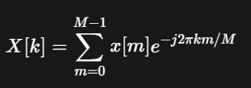

***点迹凝聚：***

把占据的多个像素合成一个位置点

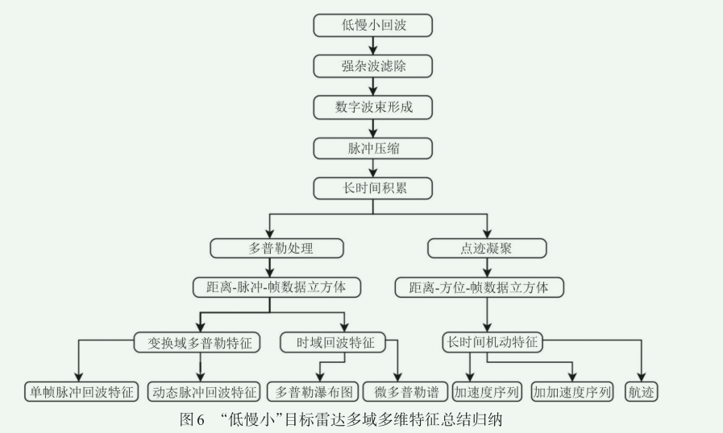