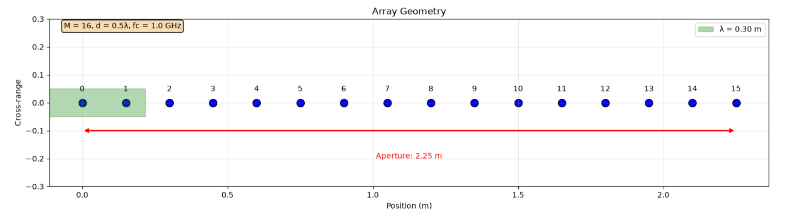
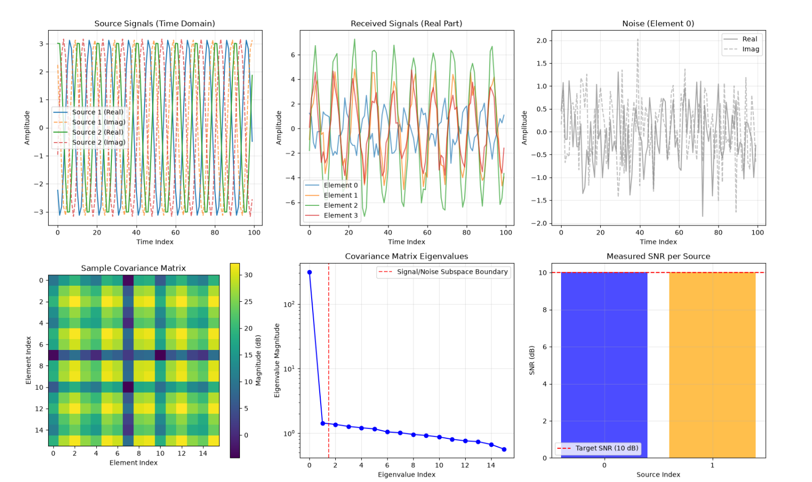
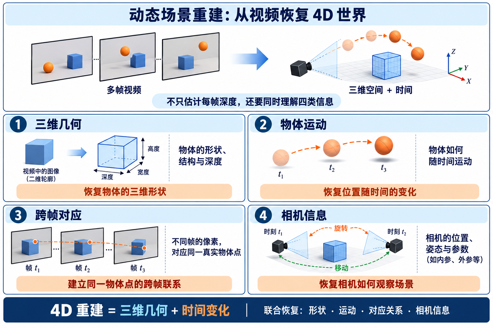
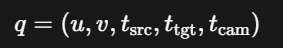
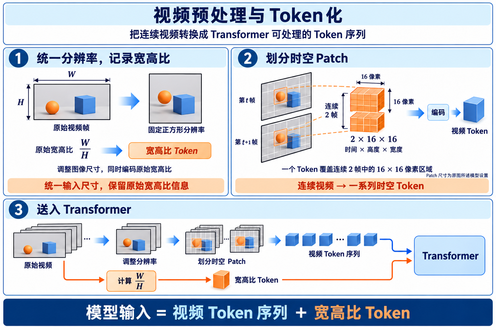

# 10.5周报

## 一.DOA测角综述（本次只过一遍测角的具体流程，不涉及一些经典方法）

### 如何理解DOA测角

我们想象一个均匀线性阵列，假设一个目标向雷达阵列发射信号（斜向发射），DOA要解决的问题就是，已知所有阵元接收到的数据，我们来估计信号从什么角度到达

### 真实世界当中接收数据是怎么产生的

1.假设信号***从角度$θ$到达阵列***

2.信号到达每个相邻阵元所产生的***路径差$ΔL=dsinθ$***

3.由路径差可以知道***时间差$Δτ=\frac{d\sin\theta}{c}$***

4.本文当中讨论的信号大多数都是窄带信号，因此可以得到***相位差$μ=\frac{2πd\sin\theta}{λ}$***

5.假设第一个阵元相位为0，将各个阵元相位依次排列，可组成***导向矢量$\mathbf{a}(\theta)=\left[
\begin{array}{c}
1\\
e^{j\mu}\\
e^{j2\mu}\\
\vdots\\
e^{j(M-1)\mu}
\end{array}
\right]$***

6.现在考虑整个阵列的接收模型，假设有K个目标，***信号波形为$s_1(n),s_2(n)...s_k(n)$***,***真实角度是$θ_1,θ_2..θ_k$***

7.***阵列接收信号$\mathbf{x}(n)=\sum_{k=1}^{K}\mathbf{a}(\theta_k)s_k(n)+\mathbf{n}(n)$***,写成***矩阵形式$x(n)=As(n)+n(n)$***

8.为了描述阵元之间的相关关系和相位关系，引入了***协方差矩阵$R=\frac{1}{N}XX^H$***,其中***$X$是快拍***，它描述的是在一个采样时刻，把所有阵元一起取出来排列在一起的数据***快拍形式**$\mathbf{x}(n)=
\left[
\begin{array}{c}
x_1(n)\\
x_2(n)\\
\vdots\\
x_M(n)
\end{array}
\right]$*，全部$N$个快拍组成***数据矩阵$X=[x(1),x(2)...x(N)]$***

***上面就是从真实世界的角度去描述从角度是如何产生接收数据的***

### DOA测角算法要怎么做

连续采集***$N$个快拍$X$*→**估计***协方差矩阵$R$***→选取***DOA算法***→提取***阵元间的空间相位结构***→进行***角度$θ_i$求解***

## 二.论文复现

### 1.创建16阵元ULA

参数设置：

16个阵元

阵元间距$d=\frac{1}{2}λ$

载频$f_c$=1GHz

### 2.$S→X=AS+N→R=\frac{1}{N}XX^H→特征值$

六张图分别表示

- 源信号图
- 阵元接收信号
- 噪声
- 协方差矩阵
- 协方差矩阵特征值
- 信噪比

## 三.动态场景重建论文（Efficiently Reconstructing Dynamic Scenes One D4RT at a Time）

### 1.论文背景

论文在讲述一个问题：如何从一段普通视频中，高效地恢复一个随时间运动的三维世界

动态场景重建需要同时理解

### 2.论文要解决的问题

从视频中同时恢复场景的几何结构和运动状态

难点：视频中通常存在两种变化

- ***相机在运动***
- ***场景当中的物体也可能在运动***

传统方法往往将任务给拆解开来，进行逐步解决，但这样的系统往往比较复杂，并且计算量较大

### 3.作者是如何做的

作者提出了一个名为 **D4RT** 的前馈模型

通过输入一段视频，模型会编码整段视频，将其整理成一个可查询的动态三维数据库

- ***$(u,v)$：目标像素位置***
- ***$t_{\mathrm{src}}$：视频的第几帧***
- ***$t_{\mathrm{tgt}}$：想看第几帧***
- ***$t_{\mathrm{cam}}$：想看第几帧的相机相对于目标的位置***

它采用统一的Transformer架构，希望同时推断三类信息：

- 深度
- 某个像素点在不同视频帧移动的过程
- 相机参数

具体例子：我们向模型提问，第 3 帧中坐标为 $(u,v)$的像素所代表的真实物体点，在第 10 帧时位于三维空间中的什么位置,因此我们需要多少三维点，就查询多少点，不必解码全部像素

接着就可以采用一个统一的接口来完成深度估计、三维跟踪、点云重建和相机参数估计

### 4.总流程图

***输入：***一整段包含多个时刻的***视频$V=\{I_1,I_2,\ldots,I_T\}$***

***编码：***视频会首先进入***编码器$F=E(V)$***，编码器会综合全部视频帧，进而提取场景外观、物体结构、物体运动、相机运动等信息，$F$也就是一个视频的全局场景表示

***解码：***模型会将***查询$q$***以及***全局表示$F$***一起送入***解码器$P=D(q,F)\in\mathbb{R}^{3}$***，然后输出$P=(X,Y,Z) $三维点

***三维点云重建：***对视频画面中的像素进行查询，就会得到***三维点$\{(u_i,v_i)\}_{i=1}^{N} \longrightarrow \{(X_i,Y_i,Z_i)\}_{i=1}^{N}$***

大量三维点就组成了***三维点云***

***三维点轨迹重建：***选择某一帧当中人身上的像素$(u,v,t_{\mathrm{src}}) $，并且保持不变，令$ t_{\mathrm{tgt}}$开始变化，模型就会输出$\ P_1,P_2,\ldots,P_T $这样的三维点，把生成的三维点连在一起，就形成了三维点轨迹$\ \mathcal{T}=\{P_1,P_2,\ldots,P_T\} $

***恢复相机参数：***模型可以查询同一批点在相机坐标系下的三维位置，在根据两组对应三维点之间的联系，来计算出相机参数，包括像相机位置、相机朝向、相机观察方向

***编码器主要负责“理解整段视频”，解码器负责“回答一个具体问题”***

### 5.输入视频预处理

