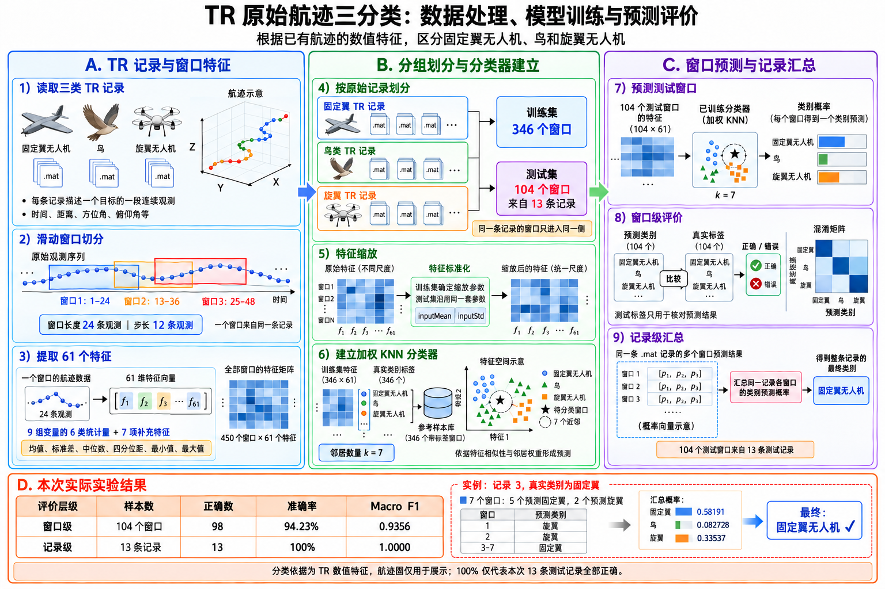
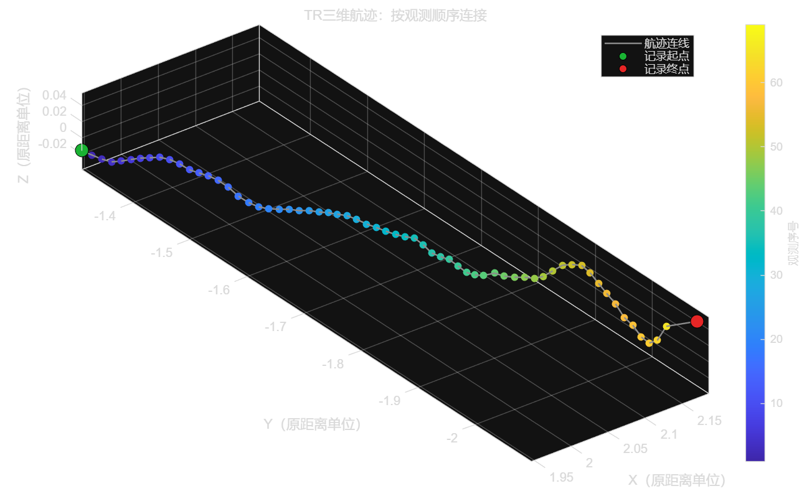
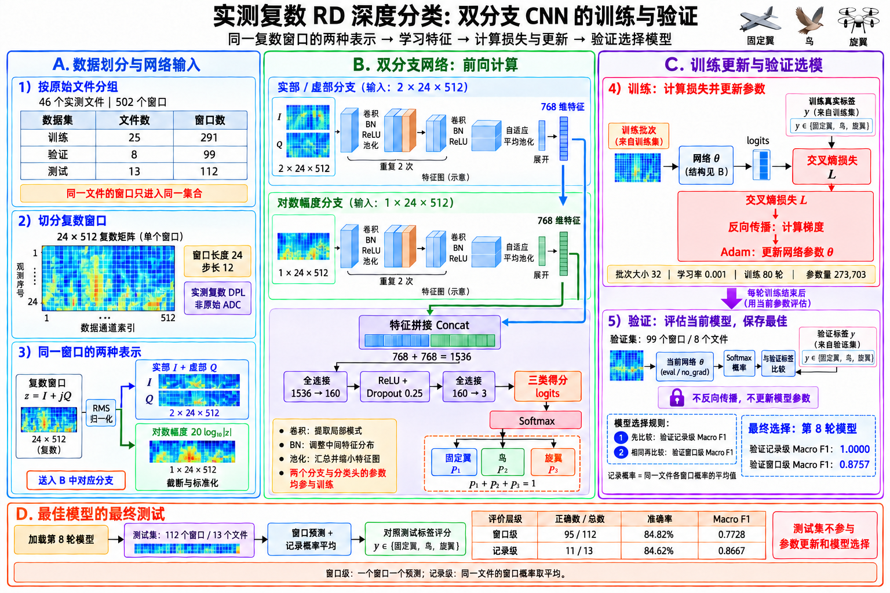
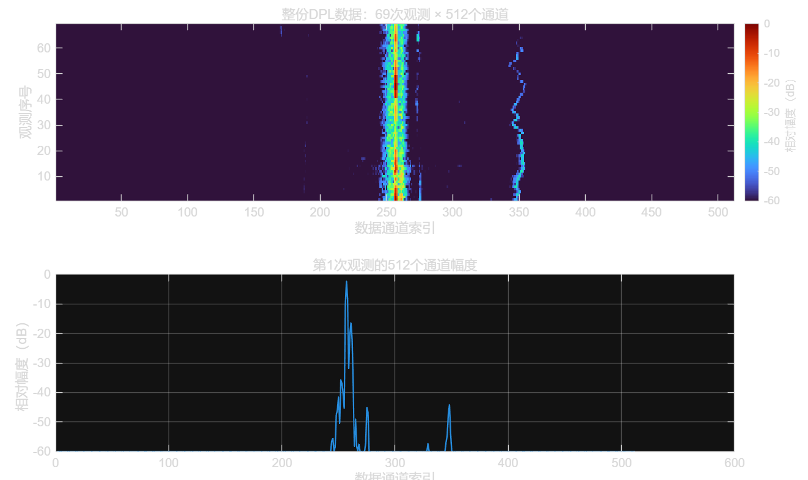
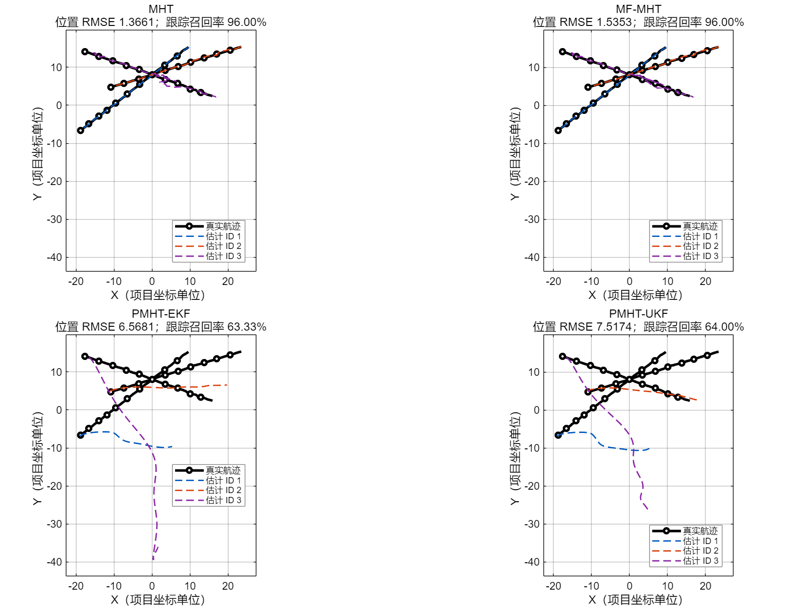
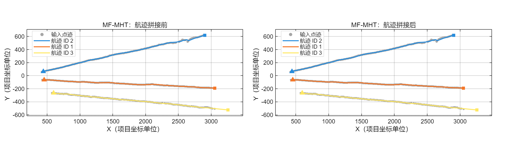

# 11.2周报

## 一.低空无人机探测项目

### 1.1 想解决什么问题

假设雷达观测到一个空中的目标，你想知道它是***鸟、固定翼无人机，还是旋翼无人机***，也就是三分类的问题

但是由于雷达所提供的不是照片，而是测量数据，因此需要利用数据中的特点来判断目标类别

### 1.2 数据集提供了什么

当前项目使用LSS-DAUR-1.0数据集，主要提供了目标的“***航迹记录***”和“***多普勒数据***”，既记录目标在怎样运动，也记录它在雷达信号中呈现什么特点

#### 1.2.1 TR航迹记录

提供目标在怎么运动的信息

观测一次可以获得一条位置与运动状态记录，连续***多次观测就构成运动序列***

这些数据可以支持

- 观察运动过程
- 提取运动特征
- 根据运动特点分类
- 为仿真实验提供运动参考

#### 1.2.2 RD多普勒数据

提供目标所在距离单元的多普勒谱复数数据，可以研究整体运动与微动在频谱中的表现

### 1.3 TR原始航迹三分类 + 实测复数RD深度分类

#### 1.3.1 TR原始航迹三分类

***实验设置与数据规模***

| 项目             | 本次设置或结果                                       |
| ---------------- | ---------------------------------------------------- |
| 实验任务         | 根据已有TR运动记录，区分固定翼无人机、鸟、旋翼无人机 |
| 窗口长度         | 24条观测                                             |
| 窗口步长         | 12条观测                                             |
| 窗口总数         | 450                                                  |
| 每个窗口的特征数 | 61                                                   |
| 训练窗口数       | 346                                                  |
| 测试窗口数       | 104                                                  |
| 测试原始记录数   | 13                                                   |
| 训练比例配置     | 0.7；按记录分组，窗口数量比例不必恰好为70%           |

一条TR记录可以切出多个窗口；同一记录产生的窗口放在训练或测试的同一侧。104个测试窗口来自13条测试记录。窗口内连续观测先被概括为61个特征，分类器再对整个窗口给出一个类别预测

***窗口级指标***

| 类别         | 实际窗口数 | 正确认出数 | 精确率（Precision） | 召回率（Recall） |     F1 |
| ------------ | ---------: | ---------: | ------------------: | ---------------: | -----: |
| 固定翼无人机 |         27 |         23 |              95.83% |           85.19% | 0.9020 |
| 鸟           |         51 |         50 |              94.34% |           98.04% | 0.9615 |
| 旋翼无人机   |         26 |         25 |              92.59% |           96.15% | 0.9434 |

精确率：预测为某一类的窗口中，实际属于该类的比例

召回率：实际属于某一类的窗口中，被正确认出的比例

f1：综合指标，描述某一类目标有没有背充分认出来，以及有没有把其他目标错认成这一类

***总体分类成绩***

| 评价层级       | 测试样本数 | 正确数 | 错误数 | 准确率（Accuracy） | 宏平均F1（Macro-F1） |
| -------------- | ---------: | -----: | -----: | -----------------: | -------------------: |
| 窗口级         |  104个窗口 |     98 |      6 |             94.23% |               0.9356 |
| 航迹级／记录级 |   13条记录 |     13 |      0 |            100.00% |               1.0000 |

Macro-F1是三个类别F1的算术平均

#### 1.3.2 实测复数RD深度分类

描述一段鸟类观测记录，雷达接收并处理后的信号，呈现出怎样的强弱分布，以及这种分布怎样随观测变化的

雷达发射电磁波→接收回波→处理回波，形成“DPL”数据→将“DPL”幅度画出来

***实验设置与输入数据***

| 项目               | 设置或结果                                                   |
| ------------------ | ------------------------------------------------------------ |
| 实验任务           | 利用实测复数DPL数据，对固定翼无人机、鸟、旋翼无人机进行三分类 |
| 使用文件数         | 46                                                           |
| 窗口总数           | 502                                                          |
| 窗口长度           | 24次观测                                                     |
| 窗口步长           | 12次观测                                                     |
| 统一后的每窗口尺寸 | 24 × 512复数矩阵                                             |
| 记录级汇总         | 同一记录各窗口的类别预测概率取平均，再选最大概率对应的类别   |

***数据划分***

| 数据部分 | 原始记录数 | 窗口数 | 用途                       |
| -------- | ---------: | -----: | -------------------------- |
| 训练集   |         25 |    291 | 更新CNN参数                |
| 验证集   |          8 |     99 | 比较各轮模型表现，选择模型 |
| 测试集   |         13 |    112 | 对选定模型进行最终评价     |

***窗口级指标***

| 类别         | 实际窗口数 | 正确认出数 | 精确率（Precision） | 召回率（Recall） |     F1 |
| ------------ | ---------: | ---------: | ------------------: | ---------------: | -----: |
| 固定翼无人机 |         22 |         18 |              81.82% |           81.82% | 0.8182 |
| 鸟           |         68 |         66 |              90.41% |           97.06% | 0.9362 |
| 旋翼无人机   |         22 |         11 |              64.71% |           50.00% | 0.5641 |

***总体测试成绩***

| 评价层级       | 测试样本数 | 正确数 | 错误数 | 准确率（Accuracy） | 宏平均F1（Macro-F1） |
| -------------- | ---------: | -----: | -----: | -----------------: | -------------------: |
| 窗口级         |  112个窗口 |     95 |     17 |             84.82% |               0.7728 |
| 记录级／航迹级 |   13条记录 |     11 |      2 |             84.62% |               0.8667 |

### 1.4 TR航迹 → K/L回波 → RD/CFAR → 点迹分类 → 航迹级分类

***实验设置***

| 项目             | 已确认内容                                        |
| ---------------- | ------------------------------------------------- |
| 项目名称         | UAV_Crossing_2_3_5                                |
| 目标类别顺序     | `fixed-wing-uav`、`bird`、`rotary-wing-uav`       |
| 真实状态矩阵     | `4 × 3 × 100`：4 个状态分量、3 个目标、100 个时刻 |
| 比较算法         | MHT、MF-MHT、PMHT-EKF、PMHT-UKF                   |
| 点迹分类合格条件 | Macro F1 ≥ 0.8500                                 |

***主要结果***

| 环节                | 本次结果                                        |
| ------------------- | ----------------------------------------------- |
| 前端目标检测        | 274 / 300；检测概率 91.33%                      |
| 前端虚假检测        | 112 / 397；虚假检测簇占比 28.21%                |
| 点迹分类            | 267 / 285 正确；准确率 93.68%；Macro F1 0.9351  |
| MHT 跟踪            | 位置 RMSE 1.3661；召回率 96.00%；精确率 100.00% |
| MF-MHT 跟踪         | 位置 RMSE 1.5353；召回率 96.00%；精确率 100.00% |
| MHT 航迹类别评价    | 258 / 262 正确；准确率 98.47%；Macro F1 0.9859  |
| MF-MHT 航迹类别评价 | 254 / 256 正确；准确率 99.22%；Macro F1 0.9940  |
| PMHT 航迹类别评价   | PMHT-EKF、PMHT-UKF 均无有效评价样本             |

在存在漏检、杂波和多个运动目标时，能不能把检测、分类和跟踪连接起来

### 1.5 实测雷达点迹 → MF-MHT → 航迹输出

***实验结果概况***

| 项目           | 实际结果                         |
| -------------- | -------------------------------- |
| 输入数据       | LSS-DAUR-1.0 的 3 份实测 TR 文件 |
| 适配后的帧数   | 160                              |
| 点迹总数       | 553                              |
| 参与比较的算法 | MHT、MF-MHT                      |

***航迹结果图***

### 1.6 单雷达干扰 → 断航 → 重捕获/航迹拼接 → 恢复评价
