# 9.21周报

## 一.《波达方向估计：经典与现代方法的教程型综述》学习

### 总的介绍：

DOA估计是***阵列信号处理***当中的基础性问题，这篇综述对于学生和刚进入该领域学习的初学者提供了综合性的介绍，关于经典的和线代的DOA估计方法的介绍。重点讨论基于***均匀线性阵列***的窄带信号处理，涵盖了经典波束形成方法、基于子空间的技术（MUSIC和ESPRIT）、最大似然方法以及稀疏信号处理方法。

### DOA估计的解释：

根据空间上彼此分离的多个阵元所获得的观测数据，来估计多个信号源的来波方向

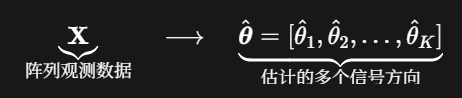

### DOA估计方法的发展路线：

经典波束形成→自适应波束形成→ 子空间方法 →最大似然方法→稀疏信号处理方法

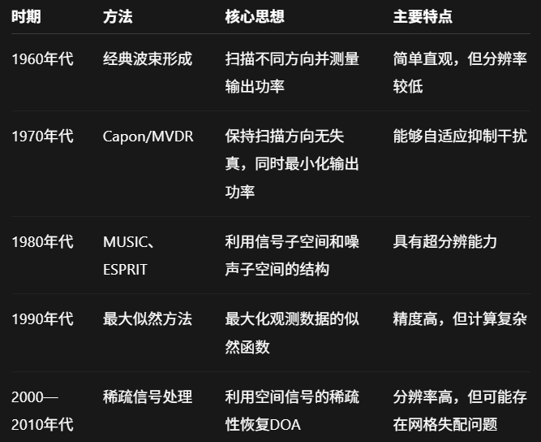

## 每个阵元接收到的雷达数据是什么样的

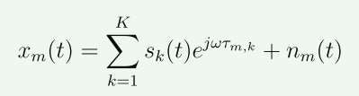

$x_m(t)$：第m个阵元接收到的总信号

$s_k(t)$：第k个信号源发出复包络

$τ_m,_k$：第k个信号到达第m个阵元的相对时延

$n_m(t)$：第m个阵元接收到的噪声

## 整个阵列的模型

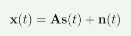

x(t) = [x1(t), x2(t), . . . , xM(t)]T

s(t) = [s1(t), s2(t), . . . , sK(t)]T

n(t) = [n1(t), n2(t), . . . , nM(t)]T

其中，A是阵列流形矩阵

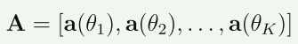

每一列都是一个方向的导向矢量，描述的是方向$θ_k$的信号在阵列上的相位分布

***导向矢量就是把同一个方向到达的信号，在所有阵元上产生的相对相位排列记录下来***

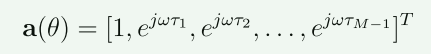

## 论文建立的数学模型是怎么样的

***假设：***

1.阵列有M个阵元

2.阵元间距$d=λ/2$

3.有N个信号，分别来自$θ_1,θ_2,θ_3....θ_N$

***整个处理流程：***

1.N个信号分别到达M个阵元

2.每个方向在阵列上形成一种相位排列

3.相位排列分别构成$a(θ_1),a(θ_2),a(θ_3)....a(θ_N)$

4.导向矢量组成阵列流形矩阵$A = [a(θ_1),a(θ_2),a(θ_3)....a(θ_N)]$

5.阵列数据$x(t) = As(t)+n(t)$

6.收集多个快拍，计算

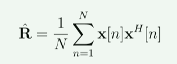

7.后续算法估计$θ_1,θ_2,θ_3....θ_N$

# 二.重新回顾下基础知识点

## 1.CFAR恒虚警率

### 解决的核心问题

当噪声和杂波功率发生变化时，如何***自动调整检测门限***，使得虚警率尽量保持在设定值附近

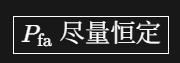

### 固定门限为什么不合适

当噪声功率较小时，采用固定门限对于目标检测的影响较小

当噪声功率较大时，此时仍然采用固定门限的话，会导致虚警率升高，而如果为了防止虚警率升高而将门限设置很高的话，又会导致检测不到目标

### CFAR滑动窗口的结构

一维CFAR窗口：

CUT待检测单元：就是当前正在要判断的单元

参考单元：用来估计CUT附近的噪声或者杂波功率

常讨论的CA-CFAR就是对参考单元的功率取平均值

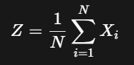

保护单元：防止目标能量污染背景噪声估计，如果没有保护单元，目标能量会进入参考单元使得噪声估计偏大，导致漏检

自适应门限：$V_T = αZ$，$α$是门限因子

### 检测的一个整体过程：

1.预先设定虚警概率（根据系统要求人为设定）

2.确定待检测单元附近参考单元数量

3.计算门限因子

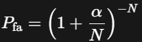

4.计算当前CUT的附近背景噪声功率

5.计算当前CUT的检测门限

6.将CUT的功率和门限进行比较，来判断是否存在目标

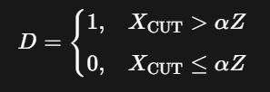

7.继续下一个CUT，重复上述过程，所有超过门限的CUT位置会成为候选目标

8.后续还需要继续进行***峰值提取***、***相邻点聚类***、***参数估计***、***目标关联或跟踪***

### 常见的CFAR算法

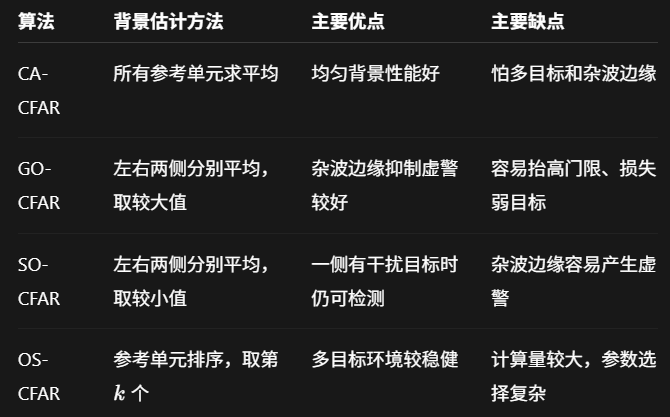

# 下周计划

把师兄发的论文看完，然后继续去总结回顾下雷达的一些基础知识，因为感觉东西有点多，需要好好理解下
