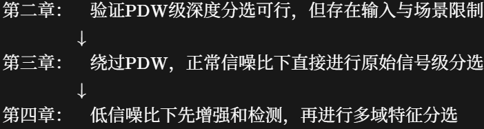
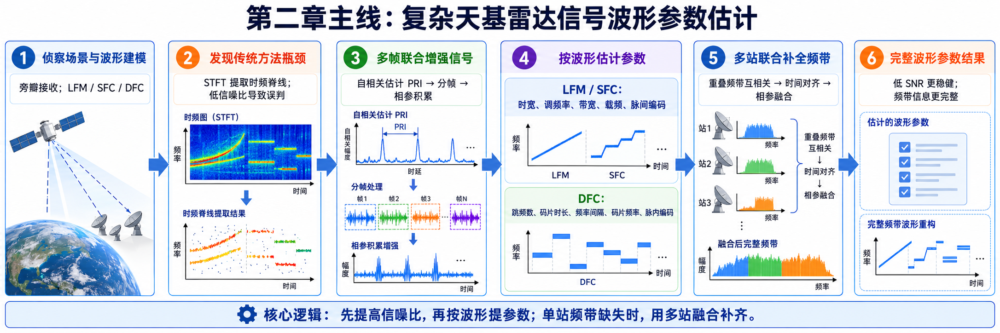
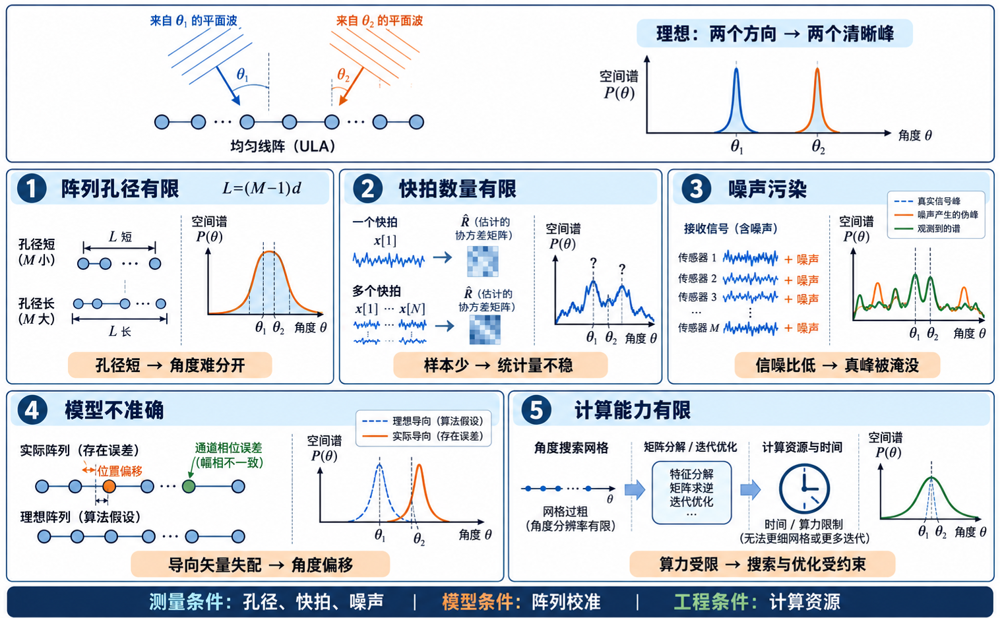
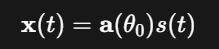
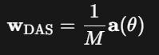
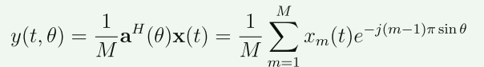
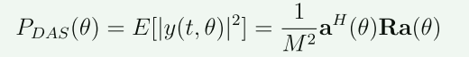
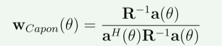
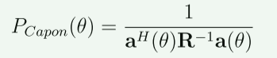
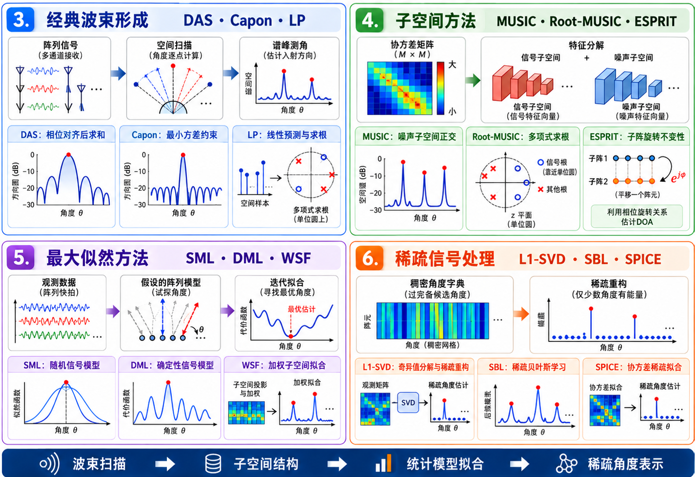

# 9.28周报

## 1.《基于深度学习的雷达辐射源分选方法研究 》

### 第三章

baseline：U-Net 

模块：卷积注意力特征提取模块（通道注意力，空间注意力）+多尺度特征融合解码模块

### 第四章

baseline：信号处理+DenseNet  

模块：移位自相关累积+单向CFAR+FFT+STFT+三分支特征提取+融合决策

comment:论文在第二章验证深度学习方法在雷达分选上的可行性，但是传统的分选方法和部分深度学习方法都依赖于PDW，并且辐射源的数量是固定的，进而进出第三章的CAU-Net分选方法，这个方法绕过了PDW，但是对于低信噪比情况下的性能较差，于是引出了第四章，即作者先对接收到的信号进行自相关累积，增强信噪比，接着通过CFAR检测来粗定位雷达信号的位置，接着通过多域融合分选的方法来完成雷达的分选

conclusion:分选知识的补充

## 2.《天基雷达信号处理与特征分析》

### 第二章

comment:论文针对天基雷达发射的信号进行检测和识别，在第二章对传统方法STFT在低信噪比情况下的瓶颈进行阐述，进而引出多帧联合相参累积的方法来增强信号。

时域参数（时宽）：通过设置自适应门限来将信号和噪声区分开来，得到脉冲信号的具体位置，然后计算脉冲采样点数，也就是脉宽，进而得到时宽

频域参数（带宽、载频、脉冲编码）：通过对相参累积增强后的信号进行“调频率搜索+解线性频调+FFT”

conclusion:本论文主要还是去理解下地面雷达站点去探测空中目标，估计信号参数和威胁等，后续的SAR成像部分后续可以看

# 3.DOA测角综述

### DOA测量的难点：

## DOA测角的主线

真实世界中信号怎样产生数据

DOA测角在解决的问题

###  一.角度如何产生相位

假设一个均匀线阵，阵元间距为$d$，信号斜着到达阵列

路程差$ΔL=dsinθ$→传播时间差$Δτ=dsinθ/c$→相位差$μ=2πfΔτ$

### 二.导向矢量

M个阵元的导向矢量可以写成$$\mathbf{a}(\theta)=\begin{bmatrix}1\\e^{j\mu}\\e^{j2\mu}\\\vdots\\e^{j(M-1)\mu}\end{bmatrix}$$，它是把各个阵元的相对相位关系写成一个向量

### 三.产生阵列数据

假设信号的波形是$s(n)$,噪声是$n(n)$，那么阵列数据为$x(n)=As(n)+n(n)$

其中$A=[a(θ_1),....,a(θ_k)]$

## DOA测角的方法

### 1.延时求和波束形成 DAS

理论：先不考虑噪声的影响，假设真实目标从$θ_0$角度到达阵列，此时接收信号就是$x(t)$,现在再人为假设一个角度$θ$,用这个角度来对$θ_0$进行匹配，当$θ=θ_0$的时候，$y(t,θ)=s(t)$了，这也就是说正确方向上的信号经过补偿之后完全同相叠加

真实过程：

先计算波束形成输出

接着计算输出功率：

这是一个随着角度而变化的功率函数，当出现峰值的时候，就是真实角度的位置

总结：$DOA$扫描候选角度，用每个角度对应的阵列相位模板对数据进行补偿和叠加，并以输出功率作为匹配程度；空间谱的功率峰值位置就是DOA估计

## 2.Capon（MVDR）

### Capon的最优权重

理论：Capon和DAS在补偿各阵元的相位之前的操作是一样的，而在后续部分会有区别。

例子：

面对来自其他方向的一个强干扰，经过针对目标方向的相位补偿之后，干扰可能呈现$[I,I,-I]$

DAS：由于DAS是采用等权平均的，假设就是$1/3$的权重，那么干扰残留就是$I/3$，此时DAS最终的输出就是$y=S+I/3$，会有噪声干扰

Capon：Capon采用的不是等权平均的想法，它保证通过合理分配权重相加后目标信号依然被保留，而尽量抑制其他方向的干扰和噪声，也就是$y=S$，Capon保证$W^Ha(θ)=1$

对每个候选角度θ，Capon重新计算一组满足$W^Ha(θ)=1$的最小输出功率权重。当候选角度没有实际来波时，阵列可以压制实际存在的其他方向分量，因此最小输出功率较低；当候选角度与某个实际来波方向一致时，该方向受到单位增益约束，不能被压制，因此Capon空间谱形成峰值。需要注意，目标和强干扰只要来自不同的真实方向，都可能在空间谱上形成峰值

# 下周计划

1.继续找一些多目标检测相关论文，还有深度学习相关的论文

2.把DOA估计这篇论文的源代码尝试跑一下
